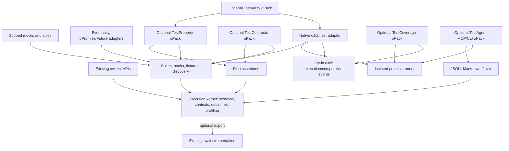

# OpenAF `ow.test` modernization plan

**Intended document:** `docs/plans/ow-test-modernization.md`  
**Status:** Accepted architecture and implementation specification. Implementation authorized on 2026-11-06; see [implementation status](./ow-test-implementation-status.md) for delivered capabilities and validation.  
**Repository baseline:** `8a56ade2e5438c9ebec68f83088460faea406b68`, inspected on 2026-11-06.

## 1. Executive summary

Modernize `ow.test` around a small, reliable execution kernel, while retaining its immediate-execution API and dependency-light character.

The foundation should provide:

- Explicit execution sessions.
- Exactly-once execution finalization.
- Thread-safe counters, profiling, and result collection.
- Structured, serializable results.
- Precise assertions.
- Lifecycle and resource ownership.
- Optional extensions that consume the same execution and result contracts.

OpenAF already supplies most underlying primitives: Java locks and atomics, channels, oPromises, process execution, HTTP clients and servers, JDBC, JSON Schema validation, instrumentation, and oJob execution. The modernization should compose these facilities rather than import another testing framework.

The user selected **fresh OpenAF processes as the default isolation boundary for native oJob tests**. This provides state separation and enforceable process deadlines. It does not, by itself, sandbox filesystem, network, or credential access.

### Top 10 recommendations

| Rank | Improvement | Impact | Relative effort |
|---|---|---|---|
| 1 | Repair profiling, destructive history reads, and duplicate finalization | Essential correctness | Low–medium |
| 2 | Introduce immutable execution records and isolated sessions | Foundation for every later feature | High |
| 3 | Preserve default failure recording while adding explicit throwing and fail-fast policies | Reliable composition without breaking suites | Medium |
| 4 | Add structured assertion errors and precise equality APIs | Better diagnostics for people and agents | Medium–high |
| 5 | Correct JUnit/Markdown output and fail-closed CI result handling | Prevent misleading CI results | Low–medium |
| 6 | Add suites, hooks, fixtures, and guaranteed cleanup | Reduces repetitive test infrastructure | High |
| 7 | Build native oJob testing with isolated workers and explicit execution events | Highest strategic OpenAF-specific value | Very high |
| 8 | Add scoped mocks and spies with ownership and restoration | Deterministic dependency isolation | Medium |
| 9 | Add eventual assertions and explicit oPromise/Future adapters | Practical asynchronous testing | Medium |
| 10 | Build optional property, contract, coverage, and verification modules on the same result model | Extensibility without core overhead | High, incremental |

### Top 5 quick wins

1. Replace the arrow-function min/max getters and remove singleton references from profile enumeration.
2. Make `getExecHistory()` return detached data.
3. Prevent duplicate timer completion, especially after nonzero external exit.
4. Correct JUnit root counts and empty-result handling.
5. Correct nonexistent `profile()` documentation and make missing/stale CI result files fail explicitly.

### Recommended order

**Phase 1 → Phase 2 → basic Phase 6 → Phase 3 → Phase 4 → Phases 5/7 → advanced Phase 6 → Phase 8 → Phase 9.**

Machine-readable results and reproducibility belong in P0; LLM integration remains P3.

### Major architecture decisions

- Keep existing public entry points and default failure behavior.
- Use an in-memory, session-owned result store as the authority; channels are compatibility views or export destinations.
- Separate correctness events from sampled instrumentation.
- Load extensions lazily.
- Run existing oJobs in fresh processes by default.
- Keep protocol-specific adapters and advanced verification in optional oPacks.
- Treat generated tests as executable, untrusted programs.
- Never describe successful tests as mathematical proofs.

### Recommended first implementation PR

**“Fix ow.test profile getters, history snapshots, and JUnit counts.”**

Limit it to the existing API, focused regressions, and documentation corrections. Cover min/max binding, receiver-local profile enumeration, repeated history reads, correct JUnit root counts, and empty XML output. Introduce no suite API or dependencies. Follow with a separate execution-finalization/concurrency PR.

---

## 2. Current implementation inventory

### Evidence classification

- **Verified source:** directly observed in the checkout.
- **Verified probe:** reproduced using the existing local JAR, version `20261106`, with checkout `js/owrap.test.js` explicitly loaded.
- **Proposal:** new behavior described in this document.
- **PoC gate:** feasibility must be demonstrated before exposing the capability.

The probes ran on macOS with Java 27. They are not Linux/Windows validation or proof that a newly built package behaves identically. No full suite or rebuild was performed. Probe-generated compilation caches were removed, and the original working-tree changes were preserved.

The local `oJob-common/oJobTest.yaml` was inspected, but it is not tracked by this repository. Findings about it describe that installed snapshot; companion changes require verification in its owning repository.

| Area | Existing implementation and exact integration points | Assessment |
|---|---|---|
| Test initialization | [js/openaf.js:7507](../../js/openaf.js#L7507), `OpenWrap.prototype.loadTest()`; [js/owrap.test.js:5](../../js/owrap.test.js#L5), `OpenWrap.test()` | Loads compiled code and initializes a singleton. No session factory. |
| Counters and reset | `owrap.test.js`, `getCountTest/Pass/Fail/Assert()`, `reset()` | Atomic individual counters; reset destroys/recreates the fixed result channel and resets configuration. |
| Assertions | `owrap.test.js:183`, `assert()`; `openaf.js:5065`, `compare()` | One equality assertion, throwing a string. Equality inherits `compare()` limitations. |
| Profiling | `owrap.test.js:46–124`, getters; `start()` at 197; `stop()` at 222 | Shared key timestamps; partial atomicity; wall-clock duration calculation. |
| Execution | `owrap.test.js:249`, `testExternally()`; 327, `test()` | Immediate execution, return body output on success, catch and record failures. |
| Results | `getChannel()` at 409; `getExecHistory()` at 418 | Fixed `__owTest::tests` channel; records grouped by message, containing atomic objects and mutable execution arrays. |
| Reporting | `toMarkdown()` at 433; `toJUnitXML()` at 482 | Built-in Markdown and XML; no versioned core JSON result envelope. |
| Legacy test script | [tests/autoTestAll.js](../../tests/autoTestAll.js) | Separate older test harness with plug callbacks and wrapper counters. It is not the area-YAML discovery mechanism. |
| Current orchestration | [tests/autoTestAll.yaml](../../tests/autoTestAll.yaml), `autoTestAll.allJobs.yaml`, area YAML/JS pairs | Explicit YAML registration of exported functions. Main orchestrator enables asynchronous execution and exposes channels. |
| Existing oJob testing | Local `oJob-common/oJobTest.yaml`: `oJob Test`, `oJob Assert`, report jobs, `oJob Test CI summary` | Supports functions, named jobs, repetition, `$path` output assertions, and reporting. It is more capable than a simple assertion wrapper, but lacks isolated workflow traces. |
| Concurrency | `openaf.js`: `$atomic()` at 15898, `syncFn()` at 7189, `$do()` at 16375, `$doWait()` at 16425, `pForEach()` at 6618, `$tb()` at 8721; `src/openaf/plugins/Threads.java` | Native reusable primitives. `$doWait()` does not automatically throw a rejected task’s exception or cancel a pending task after its wait deadline. |
| Runtime | [src/openaf/rhino/RhinoEngine.java:85](../../src/openaf/rhino/RhinoEngine.java#L85); `pom.xml` | Rhino ES6 mode; declared Rhino dependencies are 1.9.2. Ordinary Node/browser event-loop assumptions are invalid. |
| Timing and metrics | `openaf.js`, `now()`, `nowNano()`; `owrap.metrics.js`; `owrap.format.js:3927`, `percentile()` | Wall and monotonic clocks already exist. Percentile calculation sorts its input array in place. |
| JVM profiling | `owrap.java.js`, `jcmd()`, `pidStartJFR()`, `pidStopJFR()`, `pidDumpJFR()`, `parseJFR()`, `pidThreadDump()` | Reuse for optional benchmark diagnostics; not correctness coverage. |
| Instrumentation | [js/owrap.instrumentation.js](../../js/owrap.instrumentation.js), `startSpan()`, `withSpan()`, `bind()`, `withContext()`, provider registration | Thread-local context, monotonic timing, idempotent span completion, protected exporters. Disabled by default. |
| Instrumented integration boundaries | `owrap.oJob.js:2808`; `openaf.js` oPromise/thread-box bindings; HTTP wrappers | Useful trace correlation. Sampling, filters, swallowed provider errors, and handled exceptions prevent using telemetry alone as authoritative test evidence. |
| Development wrapping | `owrap.dev.js:295–489`, `JSDebug`, `setFn()`, `unSetFn()`, `setTestingWrap()` | Existing source rewriting and global tracking, with isolation/restoration limitations. |
| Debug preparsing | `owrap.debug.js`, `register()`, `debug()`, `load()`, `require()` | Comment-based checkpoints, profiling and assertions. Not a coverage engine. |
| AST support | `src/openaf/AFBase.java:1379`, `parse()`; `src/openaf/CompileJS2Java.java` | Rhino parser is available. `af.parse()` returns top-level statement source, not a complete coverage-ready AST interface. |
| Channels | `owrap.ch.js`, `simple` backend at 1293, `create/get/set/getAll/subscribe()` | Operations use locks, but values can be returned by reference; multi-operation read/modify/write sequences are not transactions. |
| HTTP/REST | `openaf.js`, `$rest()`; `owrap.obj.js`, `http`, `rest.connectionFactory()`, explicit `httpClient`; `owrap.server.js`, `httpd.start/route/stop()` | Reuse explicit clients and loopback fixtures. Connection/read/write/call timeouts exist. |
| JDBC | `src/openaf/DB.java`, `src/openaf/core/DB.java`, `qs/us/commit/rollback`; `tests/autoTestAll.DB.js` | Real DB wrapper and existing fake JDBC-interface tests. Some batch APIs commit internally. |
| MCP | `openaf.js:10160`, `$mcp()`, `initialize/listTools/callTool/destroy`; `owrap.server.js`, `mcpStdio()`, `replyJSONRPC()` | Existing clients, servers, schema metadata, and local protocol fixtures. No LLM required. |
| JSON Schema | `owrap.obj.js`, `schemaInit/Compile/Validate/Add/Remove/Generator`; [docs/json-schema.md](../../docs/json-schema.md) | Bundled Ajv with draft-07, 2019-09, 2020-12 routing. Initialization is global and first-call-wins; defaults can mutate validated input. |
| Processes | `src/openaf/AFBase.java`, `sh()`; `openaf.js`, `$sh()`; [src/openaf/OJobLanguageProcess.java](../../src/openaf/OJobLanguageProcess.java) | Structured exit results and a process-tree deadline implementation exist. Current language runner inherits environment and captures unbounded output. |
| Temporary resources | `src/openaf/core/IO.java`, `createTempFile()` and `createTempDir()` | Reuse these rather than inventing naming or directory utilities. |
| Ports | `HTTPServer.java`, `newHTTPd()` and `getPort()` | Nonpositive ports currently invoke find-free-port then bind; this has a reservation race. |
| Build and packaging | `buildos.js`, `build.yaml`, `jsmin/`, `jslib/`, compiled libraries | New wrapper modules must work through compilation and installed-JAR loading, not only source loading. |
| CI | `oafTest.sh`; `.github/workflows/build-and-test.yml`; `publish-maven.yml` | Multiple result checks exist with different strictness. Cross-platform language tests already provide a matrix pattern. |
| Documentation | `docs/testing.md`, `docs/authoring-testing.md`, `docs/openaf.md`, `docs/instrumentation.md` | Useful guidance, but contributor testing docs contain API and lifecycle inaccuracies. |

No reusable `ow.test` property-testing, mutation-testing, formal-verification, or statement/branch-coverage implementation was found in the inspected framework paths.

---

## 3. Verified bugs and architectural limitations

### Defects and required regressions

| ID | Finding and evidence | Required regression |
|---|---|---|
| B01 | `getProfileMax()` and `getProfileMin()` use lexical `this` through prototype arrow functions. Probe throws reading `__profile`. | Invoke both through `ow.test` and a session receiver after known samples. |
| B02 | `start()` replaces one timestamp per key. Nested or concurrent uses overwrite each other. Probe outer timing excluded time before the inner start. | Nested same-key timers and coordinated same-key workers preserve independent intervals. |
| B03 | `testExternally()` stops before checking exit status, then stops again in `catch`. One `/usr/bin/false` invocation produced two profile hits. | One failed command produces one execution, one failure, one timing sample. |
| B04 | Profile initialization, `sum.getSet(sum.get()+elapsed)`, min/max updates, history lookup, and array updates are not collectively atomic. A probe requesting 400 same-name tests retained 396 execution entries and 398 record hits. | Barrier-coordinated workers retain every execution and reconcile all counters. |
| B05 | `getExecHistory()` mutates live channel values by replacing atomic fields with numbers. A second call fails. | Repeated reads, reporting after reads, and further same-name tests remain valid. |
| B06 | Missing profiles throw incidental property errors; reset profiles yield `NaN` averages; `getProfile().start` changes type before/after first start. | Explicit empty-state values; no atomic objects in snapshot output. |
| B07 | `getAllProfile*()` delegates to global `ow.test` rather than its receiver. | Two independent receivers cannot read each other’s profile values. |
| B08 | Logging/channel writes occur within execution success/failure paths; failures there can trigger a second stop or conflicting counters. `setResult()` logs even with output disabled. | Throwing logger/exporter tests finalize once; disabled output suppresses callback logging. |
| B09 | JUnit root `tests` increments per suite, not testcase. Probe emitted root `tests="1"` for four cases. | Root test count equals the sum of emitted testcase counts. |
| B10 | Empty JUnit reporting dereferences a missing minimum. Probe throws. | Empty results produce valid zero-count XML. |
| B11 | Ordinary XML metacharacters are escaped correctly by `XMLBuilder2`; illegal XML characters are not normalized. NUL in a failure caused serialization failure. | Round-trip `<>&"'`; sanitize illegal XML 1.0 characters without double escaping. |
| B12 | Markdown includes unescaped names/results and raw HTML. Probe broke rows with pipes/newlines and retained `<script>` markup. | Pipes, newlines, HTML, Unicode, and long diagnostics remain safe readable cells. |
| B13 | JUnit uses millisecond starts as IDs, drops stored stack traces, and does not update suite earliest start when merging later records. | Unique IDs for same-time cases; merged timestamps and stack payloads correct. |
| B14 | Legacy `compare()` has unsuitable general-purpose deep equality semantics: undefined-valued properties compare unequal; unrelated ES Maps/Sets can compare equal; `NaN` compares unequal; Java String comparison can throw. Cycles have no visited-pair protection. | Characterize legacy behavior; separately test the new comparator matrix. Do not silently replace `compare()`. |
| B15 | `setMemoryProfile(true)` requests GC at both boundaries. Measurements describe whole-JVM heap state. One external-failure path applies `abs()` while other paths retain signed differences. | Signed heap deltas, sampling-mode metadata, no automatic GC in new default profiling. |
| B16 | `docs/testing.md` and `docs/openaf.md` show `ow.test.profile()`, which is absent. Documentation also misstates some counter/default/loading behavior. | Executable documentation examples and API inventory checks. |
| B17 | `tests/autoTestAll.js` calls success plugs after `ow.test.test()` returns, even when it recorded a failure. | Failed wrapped tests never trigger success callbacks. |
| B18 | `tests/autoTestAll.yaml` ends with `exit(0)`; `oafTest.sh` can finish without a result file and can consume a stale result. | Missing, malformed, stale, empty-required, or failing results produce nonzero runner exit. |

### Behavior to preserve or explicitly improve

These are architectural limitations, not all accidental defects:

- **Failure swallowing is the existing default contract.** `test()` and `testExternally()` record failures and normally return `undefined`.
- A successful body returning `undefined` is indistinguishable from a failed body through the legacy return value alone.
- A recorded child failure does not automatically fail a legacy parent. The probe produced two passes and one failure for a passing parent, failed child, and successful undefined-returning test.
- Counters track executions and assertion calls, not discovered definitions.
- There is no built-in suite lifecycle, assertion-plan enforcement, cancellation contract, retry model, or Promise settlement.
- All default tests share a channel and configuration.
- Reset during execution is unsafe.
- Report generation reads mutable state rather than an explicit completed snapshot.
- Error strings lose structured comparison details and usually JavaScript stacks.

The local oJob-common snapshot also contains issues requiring a companion review: the shell-test wrapper passes a command string to `test()`; the named-job branch lacks the function branch’s `asserts` initialization; report jobs read private profiling fields; and JSON `noProfile`/`noprofile` spelling differs.

---

## 4. Gap analysis

| Capability | Existing foundation | Missing capability | Priority |
|---|---|---|---|
| Reliable execution | Immediate test wrapper and counters | Exactly-once finalization, explicit outcomes, protected reporting | P0 |
| Results | Channel history | Versioned detached records, identities, errors, reproducibility metadata | P0 |
| Assertions | `assert()` and utility predicates | Typed errors, explicit equality, paths and bounded diffs | P0 |
| Suites | YAML orchestration | Standalone registration, hooks, fixtures, filtering | P1 |
| Mocking | Ad hoc replacements and JSDebug | Scoped reference-preserving mocks and restoration ownership | P1 |
| oJob verification | `$job`, logs, existing test jobs | Isolated runner, faithful execution events, composition seams | P1 |
| Eventually/async | `$do`, `$await`, `$retry`, Threads | Assertion-specific budgets, ownership, settlement and diagnostics | P1/P2 |
| Contracts | HTTP/JDBC/channels/MCP | Common expectation format and explicit mock/replay/live evidence | P2 |
| Property testing | Java random generator and schemas | Generator protocol, shrinking, case replay, distributions | P2 |
| Coverage/mutation | Parser, debugger, instrumentation | Source mapping, coverage collectors, controlled mutant execution | P2 |
| AI integration | MCP and external agents | Discovery/result schemas and bounded execution interface | P3 |
| Verification | Runtime validation and state APIs | Models, bounded exploration, optional solver interfaces | P3 |

---

## 5. Proposed architecture

### 5.1 Small core, lazy modules



Loading `ow.test` must not load oJob, HTTP servers, MCP, schema engines, coverage instrumentation, solvers, or LLM facilities.

Use existing `loadCompiledLib()` conventions for bundled modules. Modules install methods without replacing `OpenWrap.test` or previously created sessions. Synchronize first installation and preload selected extensions before launching workers.

### 5.2 Execution ownership

Introduce a proposed `Session` abstraction through:

```javascript
var session = ow.test.createSession(options);
```

A session owns:

- Registered definitions and run IDs.
- A result store and synchronization lock.
- Profiling aggregates.
- Configuration and reporter registrations.
- Active execution accounting.
- Resource and mock ownership.
- Cancellation state.

`ow.test` remains the compatibility facade for the default session.

Use `java.lang.ThreadLocal` for the active context stack, following the existing instrumentation pattern. Pass contexts explicitly across worker boundaries through `context.bind(fn)` and framework-managed async helpers. Raw Java threads are not assumed to inherit context.

Do not require enabling telemetry to propagate test context.

### 5.3 Authoritative results and channels

The kernel owns result records under a short-lived lock. User functions, hooks, serializers, channel subscribers, and reporters must run outside this lock.

Each execution follows:

`created → running → finalizing → terminal`

An atomic completion guard prevents duplicate terminal transitions. Store results and update counters together before notifying observers.

Preserve the existing default channel name and grouped legacy fields for readers. Publish detached compatibility projections. New sessions use unique private names only when a channel export is requested.

Remote/persistent channels are optional sinks, not the coordination mechanism. Export failure must not turn a failed test into a pass or erase an outcome.

Manual channel writes remain channel operations; they are not a supported way to author canonical execution verdicts. Document this boundary and characterize any discovered consumers before migration.

### 5.4 Versioned result contract

Proposed JSON envelope:

```javascript
{
  schemaVersion: 1,
  sessionId: "...",
  runs: [{
    runId: "...",
    status: "FAIL",
    complete: true,
    startedAt: "2026-11-06T13:00:00.000Z",
    durationMs: 42.5,
    environment: {
      openafVersion: "...",
      javaVersion: "...",
      os: "...",
      sourceRevision: "...",
      artifactHash: "..."
    },
    summary: {
      tests: 2,
      passed: 1,
      failed: 1,
      errors: 0,
      skipped: 0,
      todo: 0,
      timedOut: 0,
      cancelled: 0,
      blocked: 0,
      attempts: 2,
      assertions: 3
    },
    suites: [],
    tests: [],
    infrastructureErrors: [],
    artifacts: [],
    reproducibility: {}
  }]
}
```

Each logical test record contains:

- Stable definition ID, unique execution ID, suite path, source location, tags.
- Optional parent execution ID.
- Final status and `flaky` flag.
- Attempts with unique IDs, timing, assertion counts, and errors.
- Body output separately from the legacy callback’s logged result.
- Hook/cleanup errors as structured secondary errors.
- Evidence mode: `local`, `mocked`, `replay`, `live`, or `mixed`.
- Replay metadata when applicable.

Statuses: `PASS`, `FAIL`, `ERROR`, `SKIP`, `TODO`, `TIMEOUT`, `CANCELLED`, `BLOCKED`.

Run incompleteness is separate from test failure. Truncated traces, lost worker output, malformed envelopes, and missing completion records cannot produce a complete successful run.

Use explicit value envelopes for `undefined`, nonfinite numbers, Java values, and cyclic references. Never rely on JSON’s omission or coercion to represent those values.

### 5.5 Counting rules

- Legacy `getCountTest()` continues counting started test invocations.
- Each started attempt contributes once to the attempt counters; newly introduced retries therefore add attempts.
- Legacy pass/fail getters remain attempt-oriented. Started terminal errors/timeouts count as failures.
- Unstarted skipped/TODO/blocked tests do not increment legacy execution counters.
- Structured summaries distinguish logical tests from attempts.
- Suite containers are not tests.
- Every public assertion invocation counts once, including a failing invocation.
- `eventually()` counts as one assertion; polling observations are tracked separately.
- Nested assertions inside `assertThrows()` remain assertion calls, but an expected caught exception does not independently fail the test.
- Logical verdicts derive from execution outcomes, not merely from an assertion counter.
- Reporting uses a detached, internally consistent snapshot.

---

## 6. Proposed public APIs and behavior

All APIs in this section are **proposed**, except existing APIs explicitly identified.

### 6.1 Legacy compatibility and explicit outcomes

Keep:

```javascript
ow.test.test(name, fn, args);
ow.test.testExternally(name, command, timeout);
ow.test.assert(actual, expected, message, notShowDiff);
```

Allow an additive fourth execution-options argument:

```javascript
ow.test.test(name, fn, args, { failurePolicy: "throw" });
```

Add:

```javascript
ow.test.execute(name, function(context) {
  return undefined;
}, options);                           // Structured TestResult

ow.test.getResults();                  // Detached versioned result document
ow.test.createSession(options);
```

Policies:

| Policy | Behavior |
|---|---|
| `record` | Default. Record outcome and continue. Legacy calls retain their return behavior. |
| `throw` | Record, complete cleanup, then rethrow the original body exception when available. |
| `failFast` | Record and request that the owning runner stop scheduling new tests. Already-running tests finish or follow explicit cancellation policy. |

Do not use `undefined` as the new API’s success signal.

Legacy nested tests retain their default behavior. A new structured runner fails its enclosing case when a child execution fails, while preserving child identities and avoiding duplicate logical failure reporting. Legacy callers can opt into propagation.

Reporter errors are infrastructure errors. They do not reclassify an already finalized body outcome. A required reporter failure makes the run unsuccessful.

### 6.2 Profiling

Preserve `start(key) → key` and `stop(key) → elapsedMilliseconds`.

Implement:

- Per-thread, per-key LIFO stacks for implicit legacy timers.
- Explicit proposed timer handles for cross-thread ownership:

```javascript
var timer = ow.test.timer("operation");
try {
  performOperation();
} finally {
  timer.stop();
}
```

- `timer.stop()` is idempotent and returns its recorded elapsed value.
- Legacy `stop(key)` without an active frame returns `undefined` and records a diagnostic; strict mode throws a typed misuse error.
- A thread cannot implicitly stop another thread’s key-based timer.
- Use `nowNano()` for durations and wall time only for timestamps.
- Preserve millisecond public units. Do not promise exact integer nanosecond precision through JavaScript numbers.
- Maintain legacy integer-millisecond profiling projections; structured attempt timing may retain fractional milliseconds.
- Update each aggregate coherently under a profile lock. Use atomic addition rather than read-plus-set where applicable.
- Missing/empty profiles: hits and sum are zero; average, last, min, max, and active start are `undefined`.
- Define `getProfile().start` as a scalar compatibility projection of the latest start, not the timing authority.
- Reject `reset()` or `profileReset(key)` while affected executions are active.
- Use null-prototype key dictionaries or equivalent safe maps.

Add the currently documented but absent convenience only as an explicitly new API:

```javascript
ow.test.profile("operation", function() {
  return performOperation();
});
```

It must preserve return values and exceptions and finalize in `finally`.

Memory sampling remains opt-in. New profiling samples used heap without forcing GC by default. Preserve the legacy boolean option through a documented compatibility mode, label its process-wide/GC-affected nature, and keep deltas signed. Never claim per-test allocation accounting from heap differences.

### 6.3 Assertions

```javascript
assertEqual(actual, expected, message);
assertNotEqual(actual, expected, message);
assertDeepEqual(actual, expected, message, options);
assertMatch(value, regex, message);
assertContains(collection, item, message);
assertThrows(fn, expectedError, message);
assertSchema(value, schema, message);
assertApprox(actual, expected, tolerance, message);
assertType(value, type, message);
```

#### Equality contract

| Value | `assertEqual` | `assertDeepEqual` |
|---|---|---|
| Primitives | No coercion; SameValueZero: `NaN` equals `NaN`, signed zero compares equal | Same |
| `undefined` and `null` | Distinct | Distinct; absent property differs from present `undefined` |
| Plain objects | Reference identity | Own enumerable string-keyed properties, key-order independent; no inherited-property traversal |
| Null-prototype records | Reference identity | Treated as records; compare own keys and values |
| Arrays | Reference identity | Ordered elements, length, sparse-slot presence, and additional enumerable own properties |
| Dates | Reference identity | Equal valid epoch milliseconds; different invalid dates do not compare equal |
| RegExp | Reference identity | Pattern and flags; do not mutate `lastIndex` |
| ES Map | Reference identity | Unordered keys using SameValueZero/reference key semantics; values compared recursively |
| ES Set | Reference identity | Unordered membership using SameValueZero/reference semantics; no implicit structural matching of object members |
| Cyclic structures | Reference identity | Visited bidirectional object pairing; terminate and preserve alias relationships |
| Functions | Reference identity | Reference identity |
| Java arrays/lists | Underlying Java reference identity | Ordered elements through explicit adapters |
| Java maps | Underlying Java reference identity | Unordered keys under documented Java key semantics; recursively adapted values |
| Java immutable scalar wrappers | Reference identity | Same supported Java class and `.equals()`; no lossy double conversion |
| Java dates | Reference identity | Same supported Java type and time value; cross-JS conversion is explicit |
| Other Java/custom objects | Reference identity | Require an explicit comparator adapter; never fall back to empty-key equality |

Do not silently evaluate arbitrary property getters during deep comparison. Accessor properties require identity comparison or an explicit adapter. Set traversal/depth budgets; exhaustion is a comparison error, not equality.

Preserve existing `ow.test.assert()` and global `compare()` semantics initially. New methods provide the corrected contract without silently changing old suites.

`assertApprox()` accepts either a nonnegative absolute tolerance or `{absolute, relative}`:

`abs(actual - expected) <= max(absolute, relative * max(abs(actual), abs(expected)))`

Reject invalid tolerances and `NaN`. Equal infinities pass; other infinite comparisons fail. BigDecimal/large-integer comparisons require exact adapters.

`assertThrows()` accepts no matcher, a message string, a regex, or a descriptor such as `{name, message, javaClass}`. It matches the actual thrown value and returns it on success. Predicate matchers require `{predicate: fn}` to avoid confusing them with constructors.

`assertContains()` uses substring matching for strings, deep element matching for arrays/lists, and key/membership semantics for Maps/Sets. Unsupported collection types fail clearly.

`assertType()` supports an explicit vocabulary: `undefined`, `null`, `boolean`, `number`, `string`, `function`, `array`, `object`, `date`, `regexp`, `map`, `set`, plus a Java class descriptor. `NaN` is a number; finite-number checks are separate.

#### Structured errors

```javascript
{
  name: "AssertionError",
  code: "OWTEST_ASSERTION",
  operator: "deepEqual",
  message: "Unexpected user",
  path: "/address/postcode",
  expected: /* bounded value envelope */,
  actual: /* bounded value envelope */,
  differences: [
    { path: "/address/postcode", kind: "value", expected: "...", actual: "..." }
  ],
  stack: "...",
  truncated: false
}
```

Implement as an `Error`-compatible object with useful `toString()`. Preserve raw thrown values internally for rethrowing; serialize a safe diagnostic form.

#### JSON Schema isolation

Do not initialize or reconfigure the global Ajv instance from an assertion.

Add an instance-scoped schema factory to the existing schema subsystem, reusing its draft routing and compatibility code:

```javascript
var validator = ow.obj.schemaCreate({
  useDefaults: false,
  coerceTypes: false,
  removeAdditional: false,
  allErrors: true
});
```

The returned object exposes `schemaCompile`, `schemaValidate`, `schemaAdd`, and `schemaRemove`. Existing global methods retain their behavior.

The test session lazily owns one strict validator. Validation and extraction of its `.errors` are protected against concurrent reuse. Copy errors immediately. Missing external references fail; assertions do not download schemas.

### 6.4 Suites and lifecycle

```javascript
var session = ow.test.createSession({ failurePolicy: "record" });

session.suite("UserService", function(t) {
  t.beforeEach(function(c) {
    c.userService = createUserService();
    c.defer(function() {
      c.userService.close();
    });
  });

  t.afterEach(function(c) {
    c.assertEqual(c.userService.pendingRequests(), 0);
  });

  t.test("creates user", function(c) {
    var user = c.userService.create("Alice");
    c.assertEqual(user.name, "Alice");
  }, {
    tags: ["unit"],
    timeout: 1000,
    retries: 0
  });

  t.skip("unsupported provider", "Provider fixture unavailable");
  t.todo("reject duplicate names");
});

var result = session.run({ tags: ["unit"] });
```

`ow.test.suite()` and `ow.test.run()` are default-session conveniences. Suite callbacks register definitions; execution begins only at `run()`. Existing `test()` remains immediate.

Lifecycle rules:

- `beforeAll`: outer to inner, once per participating suite.
- `beforeEach`: outer to inner, once per attempt.
- `afterEach`: inner to outer, including applicable scopes whose setup failed.
- Test cleanup: LIFO, after `afterEach`.
- `afterAll`: inner to outer, followed by suite fixture cleanup.
- Continue cleanup after cleanup failures and aggregate all errors.
- Failed `beforeAll` blocks descendants and creates a suite-hook error.
- Failed `beforeEach` skips the body and produces an error.
- `afterEach` failure makes the attempt unsuccessful.
- Suites excluded entirely by filtering do not execute hooks.

Retries default to zero. Retry only eligible body/assertion failures unless explicitly configured otherwise. Do not automatically retry setup, cleanup, configuration, or infrastructure failures. Each retry receives fresh test fixtures. A later pass retains prior failures and sets `flaky: true`.

Support literal-name, stable-ID, and tag filtering. Avoid a new expression language. Tags inherit through nested suites.

Fixtures use `t.fixture(name, factory, {scope: "test"|"suite"})`; factories register disposal with the context. Context helpers include `defer()`, `tmpDir()`, and uniquely named local channels. No global “clean all channels” behavior.

### 6.5 Mocking

```javascript
session.suite("PaymentService", function(t) {
  t.test("handles processor failure", function(c) {
    var service = makePaymentService();
    var mock = c.mock(service, "charge", function() {
      throw new Error("Service unavailable");
    });

    c.assertThrows(function() {
      service.charge(10);
    }, { message: /unavailable/ });

    c.assertCalled(mock, 1);
  });
});
```

Provide:

- `mock(object, method, implementation)`.
- `spy(object, method)`.
- Standalone `mock.fn(implementation)`.
- `mock.scope(fn)` for explicit non-test scope.
- Handles with `calls()`, `resetHistory()`, `restore()`, and sequential behavior configuration.
- `assertCalled(handle, count)` and the requested object/method convenience inside the owning scope.

Call records include sequence, arguments, receiver description, return/throw outcome, and timing. Capture bounded argument snapshots at invocation.

Preserve original function references and property descriptors. Use `apply()` to preserve receiver semantics. Do not reconstruct functions from source.

Reject:

- Non-writable/non-configurable unsupported targets.
- Java-backed methods that cannot be replaced safely.
- Concurrent ownership of the same object/property by unrelated scopes.
- Global/prototype replacement in concurrent mode.
- Unscoped mutation without explicit ownership.

Nested scopes may temporarily replace an ancestor-owned mock and restore it in LIFO order.

Sequential responses have an explicit exhaustion policy; default is an unexpected-call error. Argument matchers use explicit predicates or the documented comparator. No string evaluation.

### 6.6 Native oJob testing

```javascript
var result = ow.test.ojob("orders.yaml", {
  job: "ProcessOrder",
  prerequisites: ["CheckInventory"],
  args: { orderId: 123 },
  isolation: "process",
  mocks: {
    CheckInventory: {
      action: "assignArgs",
      value: { available: true }
    }
  },
  timeout: 10000,
  expect: {
    status: "SUCCESS",
    jobsExecuted: ["CheckInventory", "ProcessOrder"],
    jobsNotExecuted: ["RejectOrder"],
    before: [["CheckInventory", "ProcessOrder"]],
    output: [
      { job: "ProcessOrder", path: "status", equals: "CONFIRMED" }
    ]
  }
});
```

Decisions:

- `job` selects a job test; omitting it tests the workflow’s original todo.
- Dependencies are execution conditions, not an automatic dependency runner.
- `prerequisites` is explicit. Do not silently synthesize successful dependency logs.
- Mocks execute only when the target would execute.
- `assignArgs` has explicit merge behavior; `throw`, `sequence`, and bounded `delay` are additional mock actions.
- Process-mode executable fixtures are referenced by file/export, never serialized closure text.
- A requested job whose body never starts is reported as blocked/skipped with a reason and fails the default “job executed” expectation.
- Full workflows preserve original scheduler and argument-sharing settings.
- Workflow output is observed per job or through explicit named-output selectors; do not invent one universal final `args` object.
- Separate workflow status from test verdict: a correctly expected workflow error can yield a passing test.

`jobsExecuted` checks body-entry membership. `jobsNotExecuted` checks absence from a complete trace. `before` checks completion-before-start relationships. Add `sequence` for exact ordered traces only when the workflow is sequential.

For parallel jobs, record event order and causal relationships without claiming deterministic scheduling.

Support declarative YAML specifications:

```yaml
version: 1
tests:
  - name: confirms available order
    workflow: orders.yaml
    job: ProcessOrder
    prerequisites: [CheckInventory]
    args:
      orderId: 123
    mocks:
      CheckInventory:
        action: assignArgs
        value:
          available: true
    expect:
      status: SUCCESS
      output:
        - job: ProcessOrder
          path: status
          equals: CONFIRMED
```

Reuse `$path` for selectors and JSON Schema for validating specifications. Reuse oJob’s existing `check.in/out/_in/_out` semantics when testing definitions. Do not interpret arbitrary assertion strings as JavaScript.

### 6.7 Eventual and asynchronous assertions

```javascript
ow.test.eventually(function() {
  var order = $ch("orders").get("123");
  return order && order.status;
}, {
  equals: "COMPLETED",
  timeout: 5000,
  interval: 100
});
```

Defaults:

- Immediate first probe.
- Monotonic deadline.
- Constant interval; optional capped exponential backoff.
- No jitter unless a seeded option is supplied.
- Probe exceptions fail immediately unless `retryOn` explicitly matches them.
- Capture final value/error, poll count, and elapsed time.
- Sleep only up to remaining budget.
- Timeout is `TIMEOUT`, not a generic equality failure.

Support returned OpenAF oPromises and Java Futures through explicit adapters. Read their settlement state and propagate rejection. A wait timeout does not imply cancellation or task termination.

Native ECMAScript Promise support remains gated: a probe showed callbacks did not run during `sleep()` but did run after `Context.processMicrotasks()`. A correct adapter must own the Rhino context, drain its queue on the owning thread, handle rejection, and enforce a deadline. Rhino documents that its microtask queue is not thread-safe. [Rhino Context API](https://javadoc.io/static/org.mozilla/rhino/1.9.1/org.mozilla.rhino/org/mozilla/javascript/Context.html)

Until that PoC passes, reject unsupported returned thenables explicitly in the new runner. Do not mark them passed synchronously.

---

## 7. Detailed phased implementation roadmap

Each phase below specifies current state, design, implementation tasks, files, prerequisites, compatibility, validation, acceptance, complexity, risk, value, and placement. File groups are expanded in Section 8.

### Phase 1 — Correctness, profiling, results, and failure handling

**Priority:** P0  
**Placement:** Core  
**Complexity:** High overall; initial fixes low  
**Relative effort:** Approximately 4–6 reviewable PRs  
**Dependencies:** None

**Current state:** B01–B18; atomic individual counters but mutable shared execution state.

**Work packages**

1. **Characterization and quick fixes.** Add direct-run self-tests that use a tiny independent `check()` helper, so framework defects cannot hide their own regressions. Fix getters, history snapshots, empty XML, and root counts.
2. **Exactly-once finalization.** Consolidate `test()` and `testExternally()` into a shared execution path with a terminal guard and `finally` cleanup. Separate body failure, cleanup failure, and infrastructure failure.
3. **Profiling correctness.** Add timer frames, monotonic durations, synchronized aggregates, explicit empty semantics, and guarded resets.
4. **Session/result kernel.** Add session ownership, stable identities, detached result snapshots, and legacy channel projections. Preserve legacy counter fields where required by existing readers.
5. **External result correctness.** Obtain the exit status from the command’s returned result object rather than reading shared `__exitcode`. Preserve legacy output return values and shell invocation semantics.
6. **Reporting and CI repair.** Introduce snapshot-based reporters; fix Markdown safety and JUnit semantics; require current-run completion evidence in CI.

**Files:** Core, report, self-test, documentation, and CI groups.

**Compatibility:** Default record policy, argument positions, successful return values, channel name, existing counters, and millisecond units remain. Empty/misused profiling behavior receives explicit documented semantics. Existing default stack-output behavior is characterized rather than changed accidentally.

**Tests and acceptance**

- Every B01–B18 regression passes or is explicitly assigned to its owning companion repository.
- A coordinated 32-worker test retains all 3,200 executions and assertions without mismatched counts.
- Nested same-key timers remain independent.
- A failed external invocation contributes exactly one sample.
- Repeated result reads and report generation leave live state unchanged.
- Throwing loggers/exporters never duplicate outcomes.
- `PASS + FAIL == started attempts` after all attempts finish, with structured categories explaining failures.
- Empty, repeated, nested, and malformed-character reports parse correctly.
- CI rejects missing/stale/malformed results.
- Existing suites retain recorded outcomes under legacy mode.

**Risks/mitigation:** Result-shape consumers and reset behavior are the largest compatibility risks. Characterize consumers first, preserve a compatibility projection, and separate internal stores from export contracts.

**Value:** Prevents false success, corrupted history, and misleading measurements.

### Phase 2 — Assertions, suites, fixtures, and discovery

**Priority:** P0 assertions; P1 lifecycle  
**Placement:** Lazy core modules  
**Complexity:** High  
**Relative effort:** Approximately 3–4 PRs  
**Dependencies:** Phase 1 result/context contract

**Current state:** One assertion, manually registered YAML tests, no suite lifecycle.

**Work packages**

1. Implement the assertion matrix and bounded structured errors.
2. Extract the instance-scoped JSON Schema factory without changing global schema behavior.
3. Add suite registration, nested hooks, filtering, skip/TODO, retries, and flaky metadata.
4. Add fixture ownership and LIFO disposal.
5. Add `runFiles()` support for trusted exported `test*` functions and new registration modules, with sorted deterministic discovery.
6. Add manifest-only discovery for tooling; executing `require()` is not advertised as read-only discovery.

**Files:** Assertion, runner, schema, result-schema, discovery, and documentation groups.

**Compatibility:** `assert()` keeps its legacy comparator. Existing YAML suites continue to work. Suites run only through explicit `run()`; immediate `test()` remains immediate.

**Tests and acceptance**

- Full equality matrix, cycles, aliasing, Java collections, large integers, sparse arrays, and getters.
- Global Ajv options cannot alter strict assertion behavior.
- Hook-order tests cover every setup/body/teardown failure position.
- Cleanup continues after multiple failures.
- Retry attempts receive fresh fixtures and preserve earlier failures.
- Filtering does not run unrelated hooks.
- Plain `java -jar … -f test-file.js` can execute a suite without oJob-common.
- Discovery errors are reported, never silently interpreted as an empty successful suite.

**Risks/mitigation:** Comparator complexity and hook semantics. Keep custom objects explicit, bound traversal, and use an exhaustive lifecycle truth table.

**Value:** Makes tests easier to author, diagnose, generate, and compose.

### Phase 3 — Scoped mocking and dependency isolation

**Priority:** P1  
**Placement:** Generic mocks in lazy core; protocol fakes in optional adapters  
**Complexity:** Medium  
**Relative effort:** Approximately 2 PRs  
**Dependencies:** Phase 2 cleanup/context ownership

**Current state:** Manual replacements in tests; JSDebug source wrapping and global registry.

**Work packages**

1. Implement function mocks, spies, descriptor-preserving replacements, and call histories.
2. Add sequential responses, explicit matchers, and unexpected-call failures.
3. Enforce scope ownership and automatic restoration.
4. Add lightweight context fixtures for channels, temporary directories, and injected dependencies.
5. Publish examples for HTTP clients, JDBC facades, process functions, and MCP clients.
6. Document Java-backed limitations and captured-reference limitations.

**Files:** Mock module, fixture helpers, focused tests, documentation.

**Compatibility:** Do not modify JSDebug or global clients as a hidden implementation dependency. Existing ad hoc mocks remain usable.

**Tests and acceptance**

- Restoration after success, assertion failure, setup failure, and cleanup failure.
- Correct `this`, thrown values, property descriptors, inherited-method restoration, and nested scopes.
- Concurrent conflicting ownership rejected.
- Java/non-writable targets fail clearly.
- Mutating an argument after a call does not rewrite the captured call snapshot.

**Risks/mitigation:** Shared object mutation and unsafe Java replacement. Prefer dependency injection and process isolation; reject targets that cannot meet restoration guarantees.

**Value:** Reduces test leakage and repetitive mocking code.

### Phase 4 — Native oJob testing and workflow verification

**Priority:** P1, strategic  
**Placement:** Lazy core adapter and minimal oJob seams; oJob-common convenience jobs in a companion PR  
**Complexity:** Very high  
**Relative effort:** Approximately 4–6 PRs  
**Dependencies:** Phases 1–3; bounded process execution

**Current state:** Singleton oJob runtime, shared channels, truncated mutable logs, top-level instrumentation, compiled `from`/`to` bodies, existing `$job()` and declarative checks.

**Work packages**

1. **Worker protocol.** Execute trusted workflows in fresh OpenAF processes with versioned request/result files, absolute worker paths, deadlines, and bounded diagnostics.
2. **Faithful loading.** Add an opt-in test configuration hook after normal authorized definition resolution and before job compilation. Preserve original definitions and loader validation.
3. **Scheduled execution events.** Add disabled-by-default internal observers around dependency decisions, state conditions, body entry/exit, catches, repeats, scheduled retries, and state changes.
4. **Job mocks.** Apply resolved named-job replacements before compilation; record target, action, and fixture provenance.
5. **Composition events.** Preserve identity for `from`/`to`/`each` components. Gate this behind the lexical-scope PoC below.
6. **Assertions and YAML specs.** Implement execution membership, causal order, input/output, errors, attempts, state transitions, and bounded invariants.
7. **Continuous workflows.** Require explicit observation budgets for periodic/subscription workflows; stop and join resources before finalizing.

**Event contract**

Each event includes run ID, invocation ID, parent invocation, job/component identity, event kind, sequence, monotonic offset, and evidence provenance. Arguments are captured only through selected redacted fields.

The current logging channel must not be reconstructed into a supposedly complete trace.

**Critical PoC: composition fidelity**

`addJob()` concatenates `from`/`to` source. Wrapping every component in a new function can change variable scope, `return`, and exception behavior.

First prove that opt-in boundary insertion/source transformation preserves:

- Shared local variables between composed fragments.
- Early returns and throws.
- Nested composition.
- `each` processing and argument mutation.
- Check-in/check-out ordering.
- Catch/recovery behavior.

If it does not, release scheduled-job tracing and pre-compilation mocking first. Mark component coverage/order unsupported. Do not substitute an approximate trace.

**Compatibility:** Existing runtime behavior must remain unchanged with observers absent. No mandatory definition edits. In-process execution is trusted, serialized, opt-in, and initially restricted to a fresh/quiescent runtime.

**Tests and acceptance**

- Run an unchanged existing fixture as both an individual job and a full workflow.
- Verify unsatisfied dependencies, `when` conditions, handled/unhandled exceptions, repeats, cron retries, nested `$job`, `from`/`to`, and `each`.
- Mocked jobs never execute their original side effects.
- Parent process channels, state, globals, and result counters remain unchanged.
- Preserve workflow concurrency; use causal assertions for parallel execution.
- Terminated/incomplete workers never return success.
- Complete traces support absence assertions; incomplete traces make those assertions inconclusive/failing.
- Disabled observer path passes existing oJob regressions.

**Risks/mitigation:** Singleton state, loader side effects, composition semantics, swallowed errors, and process cleanup. Process isolation is the default; composition support is gated; correctness events are unsampled and separately validated.

**Value:** Tests real automation behavior without one YAML orchestration job per assertion.

### Phase 5 — Integration and contract testing

**Priority:** P2  
**Placement:** Optional `TestContracts` oPack  
**Complexity:** High  
**Relative effort:** REST/replay first, then independent adapter PRs  
**Dependencies:** Assertions, fixtures, results; worker support for isolated adapters

**Current state:** Mature transports exist, but no unified contract/replay model.

**Proposed API**

```javascript
ow.test.contract.rest({
  mode: "live",
  endpoint: "http://127.0.0.1:8080/orders",
  method: "POST",
  body: { id: 123 },
  timeouts: { connect: 1000, read: 2000, total: 3000 },
  expect: { status: 201, schema: orderSchema }
});
```

**Work packages**

1. REST request/response expectations using explicit `ow.obj.http` clients.
2. Versioned recording/replay fixtures with canonical request matching.
3. Provider verification of the same stored interactions; no mandatory broker.
4. JDBC adapter with parameter-aware expectations and explicit database ownership.
5. Channel and MCP adapters using existing client contracts.
6. Process and messaging adapters with explicit exit/ack/order semantics.

**Required behavior**

- `mocked`, `replay`, and `live` modes are explicit; reports never blur them.
- Replay misses fail closed without network fallback.
- Record fixture version, protocol version, schema hashes, and normalization rules.
- Credentials are supplied by references/callbacks from environment or existing secret facilities, never embedded in recorded fixtures.
- Retry is off by default, especially for non-idempotent requests.
- Separate connection failures, HTTP errors, schema mismatches, MCP tool errors, and timeouts.
- Use transaction rollback only where the tested DB operation guarantees it; internal commits require disposable databases/schemas.
- Messaging adapters model duplicate delivery, delay, and out-of-order events without claiming exactly-once behavior.

**Files:** Optional package manifest, adapter modules, fixture schema, per-adapter tests and docs.

**Compatibility:** No changes to `$rest`, DB, channels, or MCP defaults.

**Tests and acceptance:** Loopback HTTP fixtures; deterministic replay; redaction sentinels; auth failures; malformed payloads; binary/oversized bodies; schema dialects; JDBC commit boundaries; MCP protocol-versus-tool errors; process exits; duplicate messages. Mock/replay tests require no external network.

**Risks/mitigation:** Secret leakage and overly permissive replay. Redact before persistence and require explicit normalization/matching.

**Value:** Reusable integration verification with honest evidence provenance.

### Phase 6 — Asynchronous and concurrent testing

**Priority:** Basic eventually P1; scheduling and native Promise support P2  
**Placement:** Lazy core async module  
**Complexity:** Medium for polling; high for concurrency  
**Relative effort:** One early polling PR, then 2–3 advanced PRs  
**Dependencies:** Phase 1 contexts/results; Phase 2 lifecycle; Phase 4 process isolation for hard limits

**Current state:** Native threads and oPromises exist; the test runner does not own asynchronous completion.

**Work packages**

1. Implement `eventually()` with monotonic budgets and explicit transient-error matching.
2. Add `context.spawn()`, `context.await()`, and `context.bind()` around supported primitives.
3. Track framework-owned tasks and require settlement before test finalization.
4. Add bounded scheduling with stable definition order and configurable worker count.
5. Add exclusive resource keys for tests requiring shared fixtures.
6. Evaluate native Promise settlement in owned Rhino contexts.
7. Add cancellation diagnostics and deterministic queue fixtures.

**Isolation defaults**

- Sequential execution by default.
- In-process parallel execution only for explicitly independent tests.
- Shared globals/prototype mocks require serialization or separate processes.
- Unmanaged user threads are outside automatic ownership; report that limitation.
- Cancellation interrupts cooperatively. An uncooperative in-process task poisons the session and prevents further scheduling.
- Do not restore shared mocks or release resources while a timed-out task can still use them.
- Hard termination requires a worker process.

Optional deadlock diagnostics may use `ThreadMXBean` and thread dumps. They are not complete: Java’s management interface does not monitor virtual threads. [JDK ThreadMXBean documentation](https://docs.oracle.com/en/java/javase/25/docs/api/java.management/java/lang/management/ThreadMXBean.html)

**Tests and acceptance:** Resolved/rejected/pending oPromises, Java Futures, cancellation, pool reuse, late assertions, context cleanup, worker starvation, exclusive resources, bounded fan-out, and duplicate/out-of-order fixtures. No claim of deterministic JVM scheduling.

**Risks/mitigation:** Non-cooperative execution and context leakage. Explicit task ownership, session poisoning, and process boundaries.

**Value:** Reliable testing of eventual workflows and concurrent integrations.

### Phase 7 — Property testing and fuzzing

**Priority:** P2  
**Placement:** Optional `TestProperty` oPack  
**Complexity:** High  
**Relative effort:** Approximately 3 PRs  
**Dependencies:** Assertions, structured results, fixture lifecycle

**Current state:** Seedable Java random facilities exist; no generator/shrinker framework.

**Proposed API**

```javascript
ow.test.property.forAll({
  values: ow.test.property.gen.array(
    ow.test.property.gen.integer(-1000, 1000)
  ),
  runs: 1000,
  seed: "42"
}, function(values) {
  var sorted = sortValues(values);
  ow.test.assertEqual(sorted.length, values.length);
});
```

**Work packages**

1. Define generator protocol: `sample(random, size)` and `shrink(value)`.
2. Implement integers, finite floats, strings, arrays, records/maps, JSON, choices, and custom generators.
3. Use a versioned deterministic PRNG adapter around `java.util.Random`, with explicit seed serialization and per-case derivation.
4. Implement bounded shrinking: remove chunks, reduce magnitudes, simplify characters, and shrink nested values.
5. Persist original/minimized counterexamples, seed, case index, generator version, and input values.
6. Add classifications and distribution checks.
7. Implement a deliberately limited schema-to-generator adapter and oJob input generation.

Do not claim full JSON Schema generation. Reject unsupported keywords, recursive references without bounds, and contradictory constraints. Validate generated cases with the existing schema subsystem.

Use count/size/shrink-step budgets for reproducibility; wall-time budgets provide protection but can stop at different cases on different machines.

Re-run candidate counterexamples in fresh fixtures. Non-reproducible failures are flaky evidence, not valid minimized examples.

**Library assessment**

- **Native initial implementation:** preferred for Rhino-native values, no mandatory dependency, and a small API.
- **QuickTheories:** viable optional Java adapter; Apache-2.0, seeded execution and shrinking. Its Java callback/type ergonomics need a Rhino PoC. [QuickTheories repository](https://github.com/quicktheories/QuickTheories)
- **jqwik:** mature option for Java suites, but its JUnit Platform engine is a larger architectural dependency than needed for core OpenAF. Keep optional. [jqwik guide](https://jqwik.net/docs/current/user-guide), [license/repository](https://github.com/jqwik-team/jqwik)

**Tests and acceptance:** Golden seed sequences across OS/JDKs; shrinking preserves failure; deterministic replay from stored inputs; bounded invalid-generation attempts; cyclic input rejection for JSON generators; reproducible parser/serializer counterexamples.

**Risks/mitigation:** Oversized generator scope and misleading shrinking claims. Start with a small supported domain and report “smallest found within budget,” not global minimality.

**Value:** Finds edge cases that example tests miss and produces durable regression inputs.

### Phase 8 — Coverage, benchmarks, and mutation testing

**Priority:** P2  
**Placement:** Optional `TestCoverage` oPack; minimal parser/runtime seams only if demonstrated necessary  
**Complexity:** Very high for full JavaScript branch coverage  
**Relative effort:** Independent incremental PRs after PoCs  
**Dependencies:** Results, worker execution, oJob events

**Current state:** JSDebug rewriting, debug preparsing, Rhino parser, telemetry, JFR, and percentile utilities exist. None is a complete source-coverage implementation.

**Work packages**

1. Deliver oJob scheduled-job and observed-transition coverage first.
2. Add function/line coverage PoC through Rhino debugger facilities in an isolated interpreted worker.
3. Evaluate AST instrumentation for statement/branch coverage and accurate source mapping.
4. Export LCOV and a versioned JSON format; add CI-compatible XML only with verified mappings.
5. Add optional Java coverage through JaCoCo in a child JVM, reporting Java source coverage separately from generated Rhino classes.
6. Add benchmark runs with warmup, repeated samples, environment metadata, median/p95, and historical comparisons.
7. Add restricted AST mutation operators and isolated mutant workers.

JaCoCo is an optional EPL-2.0 dependency. Pin a version supporting the selected bytecode/JDK and retain its notices; do not bundle it into ordinary test startup. [JaCoCo license](https://www.jacoco.org/jacoco/trunk/doc/license.html), [releases](https://github.com/jacoco/jacoco/releases)

**Coverage rules**

- Report only the denominator actually known.
- An observed workflow transition is not proof that every possible transition was enumerated.
- JSDebug’s line-string rewriting is unsuitable as the correctness basis.
- Parser normalization must not alter directives, lexical scope, short-circuit behavior, exceptions, or source positions.
- If source mapping is incomplete, label coverage partial and exclude unsupported files explicitly.

**Benchmark rules**

- Separate benchmark verdicts from ordinary tests.
- Keep sampling/heap/JFR overhead opt-in.
- Copy sample arrays before calling `ow.format.percentile()`.
- Record GC policy, warmup count, sample count, concurrency, Java/OpenAF versions, hardware context, and noise.
- Do not enforce universal timing thresholds in ordinary CI.

**Mutation rules**

- Begin with literal, comparison, and boolean-condition mutations on supported source.
- Keep originals untouched; use temporary copies.
- Distinguish killed, survived, invalid, timed-out, and untested mutants.
- Surviving mutants suggest weak tests; equivalent mutants prevent treating every survivor as a defect.
- Assertion redundancy is advisory evidence, never a proven classification.

**Tests and acceptance:** Golden instrumented semantics; exact fixture counts; disabled instrumentation parity; compiled/installed source mapping; mutant isolation; benchmark summary correctness.

**Risks/mitigation:** Semantic changes from instrumentation and misleading coverage precision. Separate deliverables and require semantic-equivalence fixtures before expanding support.

**Value:** Shows exercised behavior, performance changes, and opportunities to strengthen assertions.

### Phase 9 — Agent interfaces and optional verification

**Priority:** P3  
**Placement:** Optional `TestAgent` and `TestVerify` oPacks  
**Complexity:** High for agent integration; very high for formal backends  
**Relative effort:** Agent interface first; model/backend work separately gated  
**Dependencies:** Stable schemas, reproducible workers, property testing, oJob events

**Current state:** MCP infrastructure and external agents exist. `ow.test` need not call an LLM.

**Agent work packages**

1. Publish machine-readable test descriptors, capability manifests, result schemas, and replay descriptors.
2. Expose constrained MCP tools: discover, validate specification, run selected tests, retrieve results, replay counterexample.
3. Accept generated tests as files/specifications with content hashes and provenance.
4. Run them only under an explicit execution policy.
5. Return minimized failures and replay commands to external agents.
6. Keep regression-file creation and source changes outside the test runner’s authority.

`openaf/mini-a` integrates as an external consumer. No dependency on its implementation belongs in core.

**Verification work packages**

1. Preconditions/postconditions through existing validation and new assertions.
2. Runtime invariant monitors over complete observed traces.
3. Model-based tests using explicit state/transition/action definitions.
4. Bounded state exploration of pure models with finite domains and explicit depth/state budgets.
5. Optional SMT-LIB adapter for constraints whose encoding is explicit and testable.
6. Optional proof-artifact adapter for Lean or another prover when a maintained formal model justifies it.

| Method | Appropriate claim |
|---|---|
| Example tests | These examples passed |
| Property tests | These generated cases passed under this generator and budget |
| Contracts | These interactions matched this contract in the stated mode |
| Model-based tests | Observed implementation behavior matched tested model paths |
| Bounded exploration | No violation was found within the declared finite bounds |
| SMT result | This encoded formula was satisfiable/unsatisfiable, or the solver returned unknown |
| Mathematical proof | A named theorem about a specified model was checked under recorded assumptions |

Recommend native assertions, trace invariants, property tests, and bounded finite-state exploration first. Use SMT for arithmetic or symbolic constraints that would make explicit enumeration impractical. Z3 is MIT-licensed and can remain an optional external process. [Z3 repository](https://github.com/Z3Prover/z3), [license](https://raw.githubusercontent.com/Z3Prover/z3/master/LICENSE.txt)

Lean is appropriate for maintained mathematical specifications, not as the default translator for arbitrary JavaScript, Java, or oJob execution. Its separate model-to-implementation correspondence must remain explicit. [Lean repository](https://github.com/leanprover/lean4)

**Tests and acceptance:** Known valid/invalid models, bounded counterexamples, solver timeout/unknown, invalid proof artifacts, schema rejection, reproducible generated tests, denied execution policies, and attempted report tampering.

**Compatibility:** No LLM, solver, proof assistant, or MCP server starts implicitly.

**Risks/mitigation:** Untrusted execution, false proof claims, and model drift. Enforce isolation capabilities and record model/source hashes, assumptions, bounds, and backend versions.

**Value:** Provides a reliable interface for generated tests and stronger verification without confusing evidence levels.

---

## 8. File-by-file change plan

These changes define the authorized implementation roadmap. Feasibility gates remain mandatory.

| File/group | Planned change | Phase |
|---|---|---|
| `js/owrap.test.js` | Preserve facade; fix existing defects; add session kernel, timers, context/result primitives, lazy extension stubs | 1 |
| `js/owrap.test.assert.js` — new | New comparators, assertion errors, assertion methods | 2 |
| `js/owrap.test.run.js` — new | Suites, lifecycle, fixtures, discovery, retries, run orchestration | 2 |
| `js/owrap.test.report.js` — new | Pure snapshot JSON/Markdown/JUnit reporters; existing methods delegate lazily | 1–2 |
| `js/owrap.test.mock.js` — new | Scoped mocks, spies, restoration, call records | 3 |
| `js/owrap.test.async.js` — new | Eventually, supported async adapters, owned task scheduling | 6 |
| `js/owrap.test.ojob.js` — new | oJob test specification, worker requests, expectation evaluation | 4 |
| `js/owrap.test.worker.js` — new | Explicit worker entry; schema validation, isolated run, result emission | 4 |
| `js/owrap.obj.js` | Extract reusable instance-scoped schema engine factory; preserve global helpers | 2 |
| `js/owrap.oJob.js` | Opt-in definition transform and execution observer seams; composition identities only after PoC | 4 |
| `js/openaf.js` | Narrow test-context integration where needed; dedicated worker profile-suppression option; avoid abusing CDS-training flags | 4/6 |
| `src/openaf/OJobLanguageProcess.java` | Preserve public facade while delegating shared process mechanics if needed | 4 |
| `src/openaf/core/ProcessRunner.java` — proposed new | Factor existing process logic; add bounded output, explicit environment policy, worker termination diagnostics | 4 |
| `src/openaf/rhino/RhinoEngine.java` | Change only if the Promise/coverage PoC proves an engine seam necessary | 6/8 |
| `tests/autoTestAll.Test.js/.yaml` — new | Legacy characterization and core regressions | 1 |
| `tests/runTestFramework.js` — new | Standalone self-test entry, independent checks and explicit exit status | 1 |
| `tests/autoTestAll.TestLifecycle.*` — new | Assertions, hooks, filtering, cleanup, retries | 2 |
| `tests/autoTestAll.TestMock.*` — new | Ownership, restoration, spies | 3 |
| `tests/autoTestAll.TestOJob.*` — new | Worker and workflow verification | 4 |
| `tests/autoTestAll.TestAsync.*` — new | Settlement, cancellation, context isolation | 6 |
| `tests/fixtures/ow-test/` — new | Pure fixtures, XML expected structures, workflow definitions, worker failure fixtures | 1–6 |
| `tests/autoTestAll.allJobs.yaml` | Register new area orchestrators | Each core phase |
| `tests/autoTestAll.js` | Correct wrapper plug outcomes without rewriting unrelated old tests | 1 |
| `tests/autoTestAll.yaml` | Fresh-run identity, completion marker, reliable exit and report generation | 1 |
| `oafTest.sh` | Reject failed execution and missing/stale/malformed results; preserve unrelated installation changes | 1 |
| `.github/workflows/build-and-test.yml` | Structured result validation, artifact upload on failure, framework OS/JDK matrix | 1–2 |
| `.github/workflows/publish-maven.yml` | Align completion/result checks | 1 |
| `docs/testing.md`, `docs/openaf.md` | Correct existing API claims and document compatibility | 1 |
| `docs/authoring-testing.md` | Standalone suites, fixtures, evidence modes and replay | 2–9 |
| `docs/ow-test-results.schema.json` — new | Versioned result schema | 1 |
| `docs/ow-test-spec.schema.json` — new | Declarative test/workflow specification | 4 |
| `buildos.js`, `build.yaml` | Adjust only if required by new compiled module packaging; regenerate artifacts through normal build | Relevant phases |
| Owning oJob-common repository, `oJobTest.yaml` | Fix local-snapshot defects after upstream verification; consume public snapshots; add file/spec runner jobs | Companion PR |
| `openaf/openaf-opacks/TestContracts/` — proposed | Contract adapters and fixtures | 5 |
| `openaf/openaf-opacks/TestProperty/` — proposed | Generators, shrinking, replay | 7 |
| `openaf/openaf-opacks/TestCoverage/` — proposed | Coverage, benchmarks, mutation tools | 8 |
| `openaf/openaf-opacks/TestVerify/` — proposed | Models and optional solver/proof adapters | 9 |
| `openaf/openaf-opacks/TestAgent/` — proposed | Constrained MCP and CLI integration | 9 |

Do not hand-edit generated `jsmin/`, `jslib/`, JAR contents, or generated API metadata as source fixes.

---

## 9. Dependencies, integration points, and parallel workstreams

### Dependency rules

- Core uses existing OpenAF/JDK facilities only.
- Rich assertions load schema support only when required.
- Generic mocks depend on context/cleanup, not HTTP/JDBC/MCP.
- The oJob adapter depends on the runner; the runner does not depend on oJob.
- Correctness events may be mirrored into instrumentation, but instrumentation cannot determine correctness.
- Optional packages register through a versioned extension interface and declare required capabilities.
- Unsupported capabilities return explicit errors; no fake fallback to “passed.”

### Parallel implementation opportunities

After Phase 1 freezes the result contract:

1. **Assertions/schema** can proceed alongside **reporters/CI**.
2. **Lifecycle/fixtures** can proceed alongside the **oJob process/observer PoC**.
3. After lifecycle ownership is stable, **mocking** and **eventually** are independent.
4. After worker and result contracts stabilize, **contracts**, **property testing**, and **coverage PoCs** can proceed independently.
5. Agent tooling can consume schemas before formal verification backends exist.

Keep shared ownership of the result schema, finalization state machine, and context propagation. These should not evolve independently in competing workstreams.

### Dependency licensing

Use native implementations first. Optional dependencies must be pinned, checksummed, declared in their package, and accompanied by notices and a reviewed transitive-license inventory.

QuickTheories, jqwik, JaCoCo, Z3, and Lean are candidates with different integration costs; none is approved as a mandatory dependency by this plan.

---

## 10. Backward compatibility strategy

1. Characterize all existing public methods before restructuring.
2. Preserve immediate execution and successful return values.
3. Preserve default failure recording and the third `test()` argument.
4. Preserve `assert()` semantics and thrown-string compatibility initially.
5. Keep public profiling units and the default result-channel name.
6. Preserve accumulated legacy execution reporting until `reset()`.
7. Retain repeated legacy calls as separate executions, even when their names match.
8. Keep modern definitions, executions, and retry attempts distinct.
9. Introduce new behavior through additive methods/options.
10. Retain private profile compatibility projections temporarily where inspected oJob-common consumers require them; migrate those consumers to public snapshots.
11. Treat fixed counts, detached history, and valid empty reports as correctness fixes, documenting observable output changes.
12. Do not force existing test files into suites or manifests.
13. Run source-loaded, freshly built JAR, installed-package, and unrelated-working-directory checks.
14. Preserve the existing minimum runtime Java 21 and documented build requirement JDK 24+.
15. Keep optional features unavailable until their capability checks pass.

No public API removal is proposed.

---

## 11. Security, concurrency, and operational considerations

### Trusted versus untrusted execution

A new JVM separates state; it still possesses operating-system permissions.

For generated/untrusted tests:

- Require an execution provider that enforces the requested filesystem, network, subprocess, and resource limits.
- Use an ephemeral writable directory and read-only approved inputs.
- Pass an explicit environment allowlist.
- Disable user and embedded startup profiles through a dedicated worker option.
- Deny implicit package installation and remote definition loading.
- Bound heap, wall time, process count, output, artifacts, and trace size.
- Use platform-enforced process containment when required.
- If the provider cannot enforce a requested boundary, refuse execution; do not silently downgrade to a plain child JVM.

Do not treat `OAF_CLOSED`, loader authorization, a Java class filter, or the test context as an operating-system sandbox.

### Result trust

The supervisor determines process exit, timeout, and completeness. A worker’s claimed `PASS` cannot override a killed process, protocol violation, or missing completion record.

An untrusted test can still fabricate application assertions inside its own process. Reports must identify evidence provenance and trust level rather than implying independent proof.

### Resource and concurrency policy

- No shared global replacement during concurrent execution.
- Unique channel names, fixture IDs, temp directories, and worker artifact locations.
- Cleanup only resources owned by the context.
- Bounded waits for cleanup; failures remain visible.
- Never use unsafe thread termination.
- Do not reset active sessions.
- Lock short bookkeeping operations, never user callbacks.
- Define lock ordering and avoid channel callbacks while holding execution locks.
- An uncooperative task prevents safe teardown/reuse; quarantine its worker.
- Bound retained diagnostics, call histories, and traces; truncation must be explicit.

### Ports and processes

Reuse HTTP server facilities, but handle the existing free-port reservation race with bounded bind retries. True bind-to-zero support can be a separate narrow improvement; do not describe the current helper as reserving a port.

Use argument arrays and platform Java executable paths. Avoid shell interpolation for worker requests and secrets.

The existing process runner’s descendant tracking is useful but not a complete hostile-process containment mechanism. Report inability to enumerate/terminate descendants; stronger policies require a suitable external isolation provider.

### Secrets and integration data

Redact before persistence or export:

- Authorization, cookies, API keys, JDBC credentials.
- Sensitive URL/query fields.
- Selected request/response properties.
- Exception strings and stack messages that contain payloads.
- Process arguments and environment data.

Capture bodies only when explicitly enabled. Prefer allowlisted fields over comprehensive request dumping. Preserve fixture redaction placeholders consistently for replay.

### Reproducibility

Record source/JAR hashes, OpenAF/JDK versions, OS, seed, fixture/contract versions, selected test IDs, configuration, and known locale/time-zone assumptions.

A seed alone cannot reproduce live service behavior, JVM scheduling, or wall-time-budget exhaustion.

---

## 12. Test and CI strategy

### Layered validation

1. **Framework self-tests:** deterministic, no external services, independent assertion helper.
2. **Legacy characterization:** returns, counters, nested behavior, reset, output flags, channel records.
3. **Concurrency regressions:** latches/barriers and exact counts; avoid sleep-only race tests.
4. **Loopback integration:** HTTP/MCP fixtures with explicit teardown and allocated ports.
5. **Process tests:** success, nonzero exit, malformed output, excessive output, timeout, descendant handling, paths with spaces.
6. **oJob semantic fixtures:** dependency conditions, composition, sharing, catches, repeats, subscriptions, state transitions.
7. **Packaging tests:** checkout source, rebuilt JAR, installed modules, unrelated working directory.
8. **Cross-platform matrix:** Linux/macOS/Windows; Java 21 plus the supported build/current CI JDK.
9. **Optional-adapter jobs:** separate from required offline core checks.
10. **Security negative tests:** redaction sentinels, disallowed capabilities, fixture traversal, remote includes, incomplete worker reports.

### Reporting acceptance

- XML parses with a real XML parser.
- Root/suite counts reconcile with emitted cases.
- Seconds are used in JUnit; milliseconds remain internal.
- Empty runs are valid reports; CI may separately require at least one selected test.
- Names, failures, stacks, and Unicode survive safe serialization.
- Modern retries produce one final testcase with attempt details; legacy repeated executions remain separate cases.
- `FAIL` maps to `<failure>`; unexpected error/timeout to `<error>`; skip/TODO/cancellation/blocking use `<skipped>` with reasons.
- Suite hook errors use clearly named synthetic cases so CI displays them; XML counts include those emitted cases, while logical-test summaries keep hook errors separate.
- Nested suites use flattened suite paths/classnames for broad importer compatibility.
- Generic portable JUnit is the default; vendor-specific flaky extensions are optional.

### CI result handling

- Each run has a unique ID and completion marker.
- The runner writes results atomically.
- A prior file cannot satisfy the current run.
- Missing/malformed/incomplete results fail.
- The new CLI wrapper uses `0` for success, `1` for test failure, and `2` for configuration/infrastructure failure.
- The library itself does not call `exit()`.
- Upload diagnostics and reports even when tests fail.
- Keep benchmark thresholds and live integrations outside ordinary correctness gates.

---

## 13. Acceptance criteria

### Minimum coherent release

The first modernization release is complete when:

- Existing suites run without required source changes.
- Every started execution finalizes once.
- Concurrent same-name tests retain exact histories.
- Profiling handles nesting and concurrency without shared timestamps.
- Results are detached, serializable, versioned, and unambiguous.
- Rich assertions provide precise diagnostics without changing legacy `assert()`.
- Suites and cleanup work without oJob.
- Markdown/JUnit are valid for empty, repeated, nested, failing, and special-character cases.
- Scoped mocks restore reliably.
- Eventual assertions enforce deadlines.
- Native oJob tests run in fresh processes and report actual scheduled execution behavior.
- Unsupported composition/Promise/isolation capabilities are explicit.
- No optional feature imposes ordinary startup instrumentation or external dependencies.

### Extension release gates

- Property testing requires stable seed/case replay and validated shrinking.
- Contract testing requires explicit evidence modes and redacted fixtures.
- Coverage requires semantic-equivalence and source-mapping evidence.
- Mutation testing requires isolated original-preserving execution.
- Agent execution requires enforceable policy boundaries.
- Verification requires explicit method, assumptions, bounds, and artifact identities.

---

## 14. Risk assessment

| Risk | Severity | Mitigation |
|---|---|---|
| Changing legacy failure/return semantics | High | Preserve defaults; use additive policies and characterize old suites |
| oJob singleton/global state leaking | High | Fresh process default; restrict in-process mode |
| `from`/`to` instrumentation changing JavaScript scope | Very high | Dedicated PoC; release top-level capability first if fidelity is unproven |
| Timed-out work continuing after cleanup | Very high | Cooperative cancellation distinction, worker termination, no unsafe reuse |
| Result loss under parallel updates | High | Session lock, immutable outcomes, one terminal transition |
| Native Promise queue handling | High | Owned-context adapter; no generic thenable assumption |
| Schema global state/default mutation | High | Instance-scoped strict validator |
| Java interoperability ambiguity | Medium–high | Explicit adapters and unsupported-type errors |
| Coverage changing program behavior | Very high | Isolated execution and semantic golden fixtures |
| Secrets in failures and recordings | High | Redaction before storage; bounded capture |
| Generated tests escaping intended privileges | Very high | Enforced external isolation provider; fail closed |
| Successful tests being presented as proofs | High | Evidence taxonomy in schema and reporters |
| Feature growth overwhelming the core | Medium | Lazy modules, optional oPacks, phase gates |
| Packaged behavior differing from source-loaded tests | High | Rebuild/install/unrelated-cwd acceptance |
| Optional dependency/license burden | Medium | Pin and review per oPack; no mandatory additions |

---

## 15. Prioritized implementation checklist

### P0

- [ ] Characterize every existing `ow.test` public API.
- [x] Fix getter binding and receiver-local enumeration.
- [x] Fix destructive history reads.
- [x] Correct JUnit counts and empty output.
- [x] Introduce exactly-once execution finalization.
- [x] Replace shared timer starts with owned frames.
- [x] Make aggregate updates and result commits concurrency-safe.
- [x] Add versioned detached results.
- [x] Add explicit failure policies.
- [x] Add structured assertions and strict schema instances.
- [x] Make CI reject missing/stale/incomplete results.
- [x] Correct documentation inaccuracies.

### P1

- [x] Add suites, hooks, filtering, skip/TODO, and retries.
- [x] Add fixtures and automatic cleanup.
- [x] Add scoped mocks/spies.
- [x] Add eventual assertions.
- [x] Add native oJob isolated worker execution.
- [x] Add scheduled-job events and workflow assertions.
- [x] Prove or explicitly defer composition tracing.
- [x] Update oJob-common through its owning repository.
- [ ] Validate the framework on Linux/macOS/Windows.

### P2

- [x] Add contract/replay REST support.
- [x] Add independent JDBC/channel/MCP/process adapters.
- [x] Add property generators, shrinking, and replay.
- [x] Add bounded concurrent scheduling.
- [ ] Validate native Promise support before enabling it.
- [ ] Add workflow coverage, then source coverage.
- [ ] Add separate benchmarks and mutation testing.

### P3

- [ ] Publish constrained MCP discovery/run/replay tools.
- [ ] Add generated-test execution policy providers.
- [x] Add model-based testing and bounded exploration.
- [x] Add optional SMT backends for justified use cases.
- [ ] Add proof-artifact integration only for maintained formal specifications.

---

## 16. Deferred or rejected alternatives

| Alternative | Decision |
|---|---|
| Replace `ow.test` with Jest/Mocha/JUnit | Reject; mismatched runtime and unnecessary dependency/compatibility cost |
| Change legacy `assert()` to new deep equality immediately | Reject; add explicit new assertions first |
| Make all failures throw by default | Reject; breaks current suites and orchestration |
| Treat `new OpenWrap.oJob()` or execution IDs as isolation | Reject; constructor returns the singleton and state remains shared |
| Use sampled telemetry as the test result database | Reject; sampling/filtering/export failures can remove evidence |
| Implement mocks through `toString()`/`eval()` | Reject; loses closures and restoration guarantees |
| Rewrite Java/native/final methods transparently | Reject in core; explicit adapters or optional specialized JVM tooling |
| Treat a child JVM as an untrusted-code sandbox | Reject |
| Promise support based only on a `.then` property | Reject |
| Full JSON Schema generation in v1 | Defer; support a declared subset |
| Mandatory jqwik/QuickTheories | Reject; optional Java adapters only |
| Automatic database rollback as universal cleanup | Reject; operations can commit internally |
| Replay miss falling back to live traffic | Reject |
| Full deterministic scheduling of arbitrary Java threads | Defer indefinitely; offer controlled fixtures and explicit schedules |
| Statement/branch coverage through line-string rewriting | Reject |
| Mutation score as proof of adequate testing | Reject |
| Automatic Lean translation of arbitrary oJobs/JavaScript | Reject as a default architecture |
| Mandatory broker, database, daemon, or external runner | Reject |
| Core LLM integration | Reject; external agents consume the framework |
| Full oJob instance-isolation refactor before useful testing | Defer; process isolation delivers value sooner |

---

## 17. Open technical questions and proof-of-concept gates

These questions do not block Phase 1. Each has a defined experiment and fallback.

| Question | Required experiment | Default/fallback |
|---|---|---|
| Can compiled oJob composition retain faithful component boundaries? | Compare original and instrumented fixtures with shared locals, returns, exceptions, `each`, and nested composition | Ship scheduled-job tracing only until fidelity is proven |
| Can native Promise queues be owned safely across supported Rhino modes? | Test settlement/rejection, microtask draining, worker contexts, timeouts, and packaged execution | Support oPromise/Future only; reject unsupported thenables |
| Can isolated Ajv instances reuse current draft routing without global leakage? | Two concurrent validators with different options and overlapping schema IDs | Keep strict validation behind the new factory; do not mutate globals |
| Which Java objects need built-in comparison adapters? | Rhino tests for reference identity, wrappers, collections, dates, large numbers, and proxy objects | Explicit unsupported comparator error for unproven types |
| Does Rhino debugger coverage retain useful source positions for compiled libraries? | Source versus interpreted/compiled fixture comparison | Function/line-only or source-only coverage, clearly labeled |
| Can AST probes preserve all supported JavaScript semantics? | Semantic golden suite and source-map round trips | No branch-coverage claim for unsupported syntax |
| Which platforms can enforce hostile process-tree limits? | Provider capability tests on Linux/macOS/Windows | Refuse untrusted execution without an adequate provider |
| Can HTTP implementations bind port zero directly? | Test all supported backends and actual bound-port reporting | Bounded retries around the existing helper |
| Which external consumers depend on private profile/channel shapes? | Search owning oPacks and validate their supported versions before release | Preserve compatibility projections during migration |
| How much history can remain in memory by default? | Measure representative large suites with bounded diagnostics | Retain complete ordinary runs; explicit archival/export limits for large runs |
| Which optional Java property library has the best Rhino ergonomics? | Small adapter PoC with shrinking and replay | Native initial property module |
| Which workflow properties justify SMT or proof tooling? | Demonstrate a concrete property that simpler testing/exploration cannot address economically | Native assertions, properties, and finite-state exploration |

---

## 18. Smallest coherent architecture

The smallest coherent architecture is **one reliable execution kernel with explicit sessions, owned contexts, exactly-once outcomes, and a versioned result contract**, surrounded by lazy assertions, lifecycle, reporting, mocking, and oJob adapters.

That kernel should reuse OpenAF’s existing clocks, locks, atomics, channels, schema facilities, process execution, and instrumentation patterns. It should remain usable through today’s `ow.loadTest()`, `test()`, and `assert()` calls.

Native oJob testing needs one additional foundation: **a fresh-process harness plus opt-in, faithful execution events**. Existing singleton construction, shared channels, compiled composition, and truncated logs make this necessary; adding more assertions around `$job()` alone would not provide reliable workflow verification.

Property testing, service contracts, coverage, mutation testing, agent access, and formal backends can then be optional consumers of the same contexts and results. This keeps ordinary tests lightweight while making stronger verification possible—and ensures every report states exactly what was executed, what was observed, and what remains unproven.
